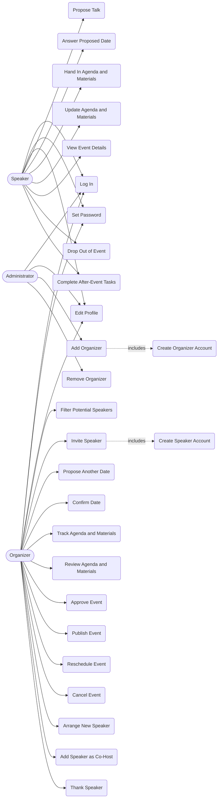

# Eventhub — Use Cases

## Accounts

Speakers can't create their own accounts. An organizer creates each one by sending the invitation, and the speaker only sets a password.

Organizers can't create their own accounts either. An administrator creates each one by adding the organizer to the community, and the organizer only sets a password. Removing an organizer stops them logging in, and their past work stays.

Keep `registrationAllowed: false` when the real realm is set up.
