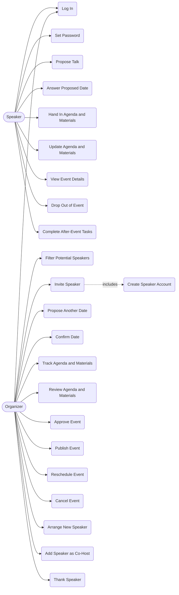

# Eventhub — Use Cases

## Accounts

Speakers can't create their own accounts. An organizer creates each one by sending the invitation, and the speaker only sets a password. Keep `registrationAllowed: false` when the real realm is set up.
