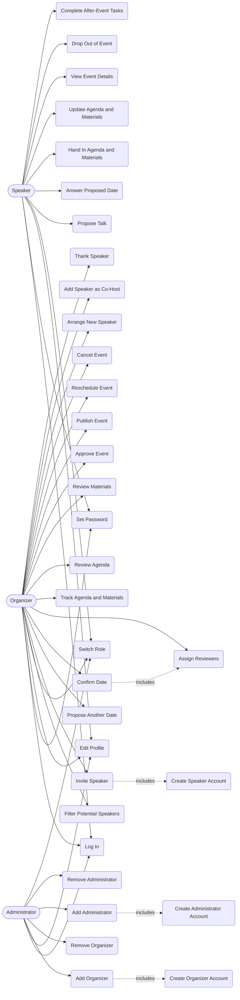

# Eventhub — Use Cases

## Accounts

Speakers can't create their own accounts. An organizer creates each one by sending the invitation, and the speaker only sets a password.

Organizers can't create their own accounts either. An administrator creates each one by adding the organizer to the community, and the organizer only sets a password. Removing an organizer stops them logging in, and their past work stays.

Administrators are added the same way. An existing administrator adds them with the same invitation as organizers, and the new administrator only sets a password. Administrators can remove other administrators, and themselves.

A community always keeps at least one organizer and one administrator. Removing the last organizer is blocked, and the Organizers tab says why: add another organizer first. Removing the last administrator is blocked in the same way.

## Several roles

One person has one login and one profile, whatever roles they hold. The roles sit on their account, so a speaker who is also an organizer or an administrator never needs a second login.

Adding someone who already has an account gives them the new role on that account. They log in as normal, with no new password.

A person with more than one role switches role from the account menu. It lists only the roles they hold, and each role opens on the screen they used last. A speaker who is also an administrator reaches their own events this way, without logging out.

Removing a role takes away only that role. The person keeps their login, their profile and their other roles.

Keep `registrationAllowed: false` when the real realm is set up.

## Assign Reviewers

Every event has one or more assignees. They review and approve it. Being assigned isn't general ownership: it only means being responsible for the review.

The organizer who confirms the date chooses the assignees. They are on the list to start with, so the event appears under Assigned to me for them straight away. Any organizer can change the assignees later from the event, for example when someone is away.

Only assignees can approve a task or send it back to the speaker. Other organizers can read the review but not act on it. Everything else stays open to every organizer: inviting, confirming dates, tracking materials, publishing, rescheduling and cancelling. That way an event never stalls while an assignee is away.

The agenda and the materials are two separate tasks, each reviewed and approved on its own. The agenda is reviewed as soon as it's in, so a wrong agenda is caught before the speaker builds slides around it. The speaker can still work ahead, but materials built on an agenda that's later sent back may need changes.

A task is approved only when every assignee has approved it. One assignee follows the same rule.

| Situation | What happens |
|---|---|
| One assignee sends it back and another has already approved | It goes back to the speaker straight away |
| The speaker sends an update | All approvals on that task are cleared |
| An assignee changes the title after someone else approved | Approvals on the agenda are cleared |
| An assignee is away and the event is stuck | Any organizer can change the assignees |
| An assignee is removed | Their pending approval goes away, and the task is approved if everyone left has approved |
| The last assignee is removed | The event has no assignees until someone is added |
| An assignee is added partway through | They must approve any task that isn't approved yet. Approved tasks stay approved |
| An organizer is removed from the community | They're taken off their events, as above, and the administrator sees which events are left with no assignees |

Organizers land on Events, which has four filters. It always opens on Assigned to me.

| Filter | What it shows |
|---|---|
| Assigned to me | The events assigned to them. Events waiting for their approval come first. Once they've approved, an event moves down, even if it's still waiting for another assignee. Events waiting for the speaker come after those |
| Unassigned | Events nobody is assigned to yet: ones with no assignees left, and ones before a date is confirmed. Any organizer can pick them up |
| All | Every upcoming event by month, with its stage and assignees |
| Past | Finished and cancelled events, newest first |

Within each group, the soonest event comes first. An event with no assignees stands out in warning colour and comes first under Unassigned and All, because nobody is looking after it. Each event opens at the step that needs work. Potential speakers has its own page, because proposals don't belong to an event yet.
