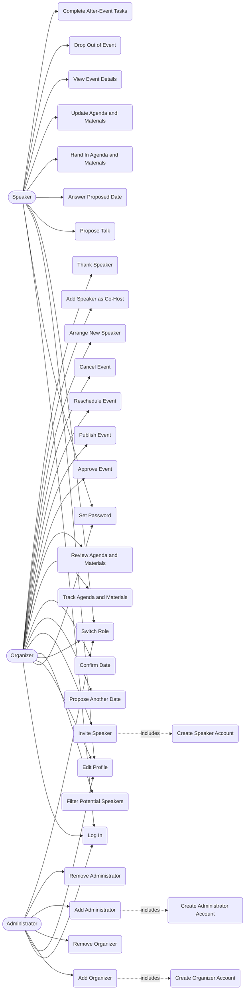

# Eventhub — Use Cases

## Accounts

Speakers can't create their own accounts. An organizer creates each one by sending the invitation, and the speaker only sets a password.

Organizers can't create their own accounts either. An administrator creates each one by adding the organizer to the community, and the organizer only sets a password. Removing an organizer stops them logging in, and their past work stays.

Administrators are added the same way. An existing administrator adds them with the same invitation as organizers, and the new administrator only sets a password. Administrators can remove other administrators, and themselves.

A community always keeps at least one organizer and one administrator. Removing the last organizer is blocked, and the Organizers tab says why: add another organizer first. Removing the last administrator is blocked in the same way.

## Several roles

One person has one login and one profile, whatever roles they hold. The roles sit on their account, so a speaker who is also an organizer or an administrator never needs a second login.

Adding someone who already has an account gives them the new role on that account. They log in as normal, with no new password.

A person with more than one role switches role from the account menu. It lists only the roles they hold, and each role opens on the screen they used last. A speaker who is also an administrator reaches their own events this way, without logging out.

Removing a role takes away only that role. The person keeps their login, their profile and their other roles.

Keep `registrationAllowed: false` when the real realm is set up.
